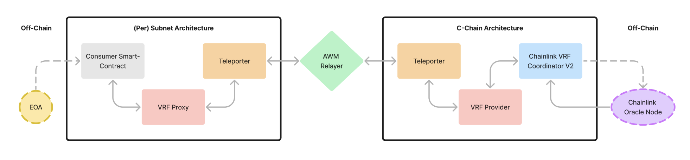

# Subnet VRF by NIMA

[](https://github.com/NIMA-Enterprises/subnet-vrf/actions/workflows/lint.yml)
[](https://github.com/NIMA-Enterprises/subnet-vrf/actions/workflows/test.yml)
<!---[](https://github.com/NIMA-Enterprises/subnet-vrf/actions/workflows/slither.yml)--->

## Architecture
Architecture is modular and consists of 4 smart-contracts:
- `VRFProvider` -> A singleton c-chain contract, takes `$LINK` deposits and is a gateway for VRF requests from subnets. Verifies that a call is coming from a verified subnet proxy and forwards the request to Chainlink.

- `VRFProxyRegistry` -> A singleton c-chain contract, being the registry of supported/official subnet proxies. It enables seamless VRFProvider migrations/upgrades. Inherits access-control.

- `VRFProxy` -> A smart contract deployed per subnet, serving as a gateway for VRF requests of consumers of a specific subnet. Verifies that a call is coming from a verified consumer and forwards the request to c-chain VRFProvider through the Teleporter.

- `VRFConsumerRegistry` -> A smart contract deployed per subnet, the registry of allowed consumers. It enables seamless VRFProxy migrations/upgrades. Inherits access-control.

Bonus: - `MockConsumer` -> Simple example testing contract, number guessing game. Once you call `takeAGuess()` VRF request will be sent through the arch. In a short while you will be able to check a response and see if it's fulfilled.

## Usage

### Build

```shell
$ forge build
```

### Test

```shell
$ forge test
```

### Format

```shell
$ forge fmt
```

### Deploy

Deployment script deploys the 4 main contracts + mock consumer for testing

```shell
$ ./scripts/deploy.sh
```

### Test Arch

Mock consumer provides features of a basic guessing game. Using the following scripts you can make a guess of a random number and later check if the request has been fulfilled.

```shell
$ ./scripts/takeAGuess.sh
```

```shell
$ ./scripts/checkResponse.sh
```
